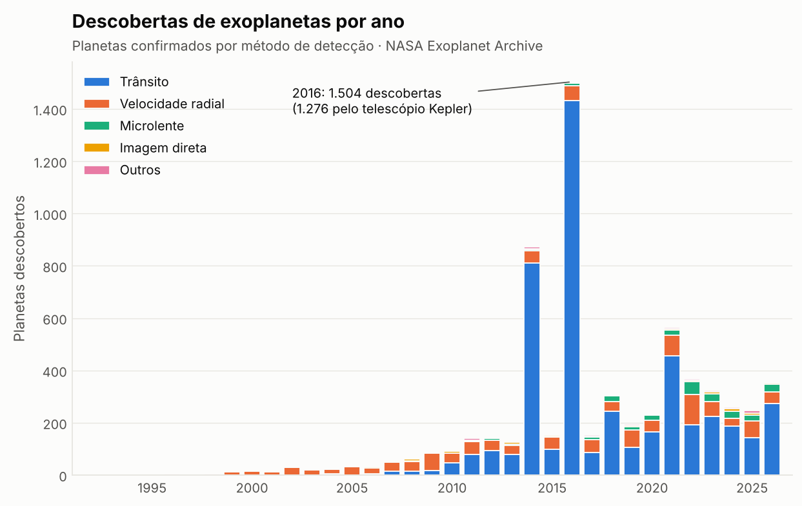
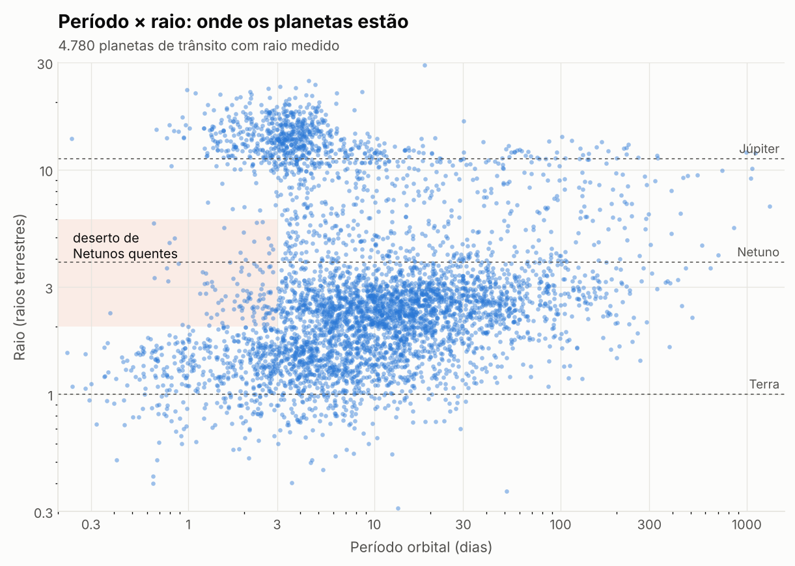
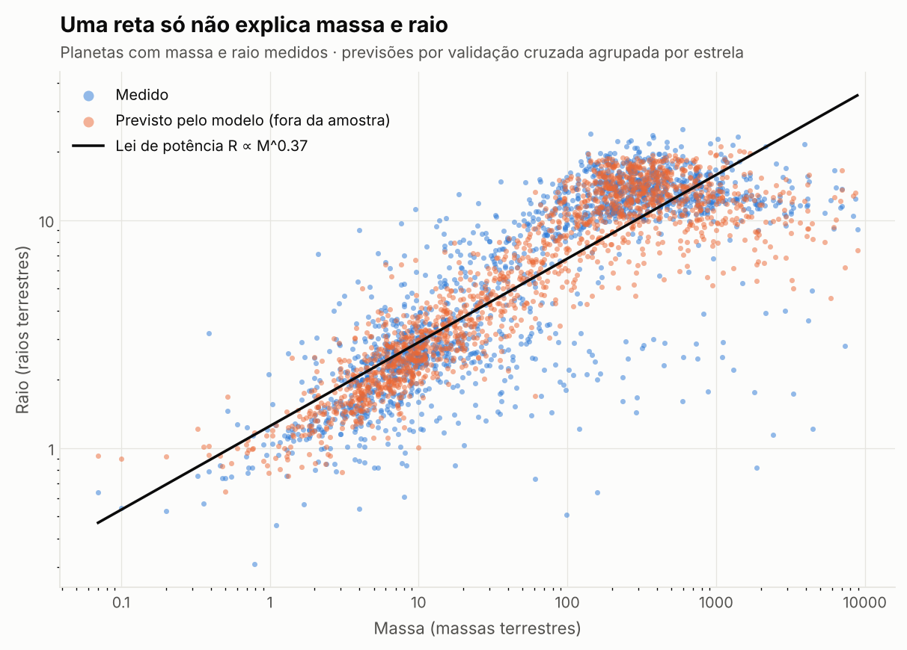
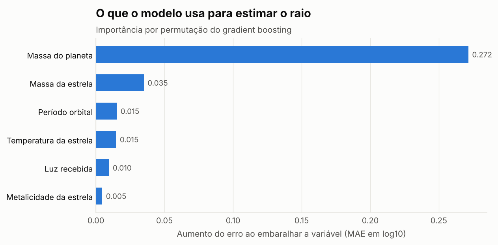

<h1 align="center">Exoplanetas</h1>

<p align="center">
  Análise de dados e Machine Learning com os <b>6.445 exoplanetas confirmados</b> do NASA Exoplanet Archive.<br>
  O que os dados mostram sobre onde os planetas estão, e quão bem dá para estimar o tamanho de um planeta que ninguém viu passar na frente da estrela.
</p>

<p align="center">
  <a href="https://github.com/AknoLeonel/exoplanetas/actions/workflows/ci.yml"></a>
  
  
</p>

---

## Em números

| | |
|---|---|
| Planetas confirmados | **6.445**, em 4.842 estrelas |
| Período das descobertas | 1992 a 2026 |
| Ano com mais descobertas | **2016**: 1.504 planetas, 1.276 deles pelo telescópio Kepler |
| Erro mediano do modelo de raio | **18,6%**, contra 29,1% de uma lei de potência e 60,7% de chutar a mediana |

Coleta de 14/10/2026. Todos os números deste README saem de [`reports/metricas.json`](reports/metricas.json), gerado pelo pipeline.

## 1. Como os planetas foram encontrados

<picture>
  <source media="(prefers-color-scheme: dark)" srcset="reports/figuras/descobertas-escuro.png">
  
</picture>

| Método | Planetas |
|---|---:|
| Trânsito | 4.781 |
| Velocidade radial | 1.203 |
| Microlente | 292 |
| Imagem direta | 97 |
| Outros | 72 |

Até 2009, **77%** das descobertas vinham da **velocidade radial** (o "balanço" que o planeta provoca na estrela). Em 2010, o **trânsito** (a pequena queda de brilho quando o planeta passa na frente da estrela) passou à frente e nunca mais perdeu a liderança. Os dois picos são as validações em massa de candidatos do Kepler: 784 dos 872 planetas de 2014 e 1.276 dos 1.504 de 2016.

## 2. Onde os planetas estão: o deserto de Netunos quentes

<picture>
  <source media="(prefers-color-scheme: dark)" srcset="reports/figuras/periodo-raio-escuro.png">
  
</picture>

Entre os 4.780 planetas de trânsito com período conhecido, **44,2%** têm o tamanho de Netuno (2 a 6 raios terrestres). Nas órbitas de menos de 3 dias, essa fração cai para **13,5%** (de 792 planetas). Isso acontece apesar de o método de trânsito favorecer justamente as órbitas curtas. A explicação mais aceita é que, tão perto da estrela, a radiação arranca a atmosfera desses planetas: os gigantes são pesados demais para perdê-la, e os rochosos não tinham uma para perder.

| Tamanho (raio medido) | Planetas |
|---|---:|
| Terra (< 1,25 R⊕) | 541 |
| Super-Terra (1,25 a 2) | 1.134 |
| Netuno (2 a 6) | 2.113 |
| Júpiter (6 a 15) | 774 |
| Super-Júpiter (> 15) | 218 |

Os planetas mais próximos de nós com raio medido parecido com o da Terra e que recebem entre 0,25 e 2 vezes a luz que a Terra recebe são **Gliese 12 b** (12,2 parsecs) e quatro planetas de **TRAPPIST-1** (12,4 parsecs).

## 3. Modelo: estimar o raio a partir da massa

**Pergunta:** quando só a massa de um planeta é conhecida (como na velocidade radial), dá para estimar o raio dele?

<picture>
  <source media="(prefers-color-scheme: dark)" srcset="reports/figuras/massa-raio-escuro.png">
  
</picture>

| Modelo | Erro mediano | Dentro de 20% | R² (log) |
|---|---:|---:|---:|
| Mediana (referência) | 60,7% | 5,3% | -0,06 |
| Lei de potência massa-raio | 29,1% | 32,4% | 0,68 |
| **Gradient boosting** (todas as variáveis) | **18,6%** | **53,1%** | **0,79** |

Uma única lei de potência (R ∝ M^0,37) erra porque a física muda com a massa. Planetas rochosos crescem com a massa, mas acima de cerca de 100 massas terrestres o gás se comprime e o raio **para de crescer**: Júpiter e planetas dez vezes mais pesados têm quase o mesmo tamanho. O gradient boosting aprende essa curva sozinho e usa as variáveis da estrela para refinar a previsão.

<picture>
  <source media="(prefers-color-scheme: dark)" srcset="reports/figuras/importancia-escuro.png">
  
</picture>

### Cuidados que tornam o resultado confiável

- **Sem vazamento de dados.** Na tabela da NASA, **3.032 massas** não foram medidas: foram calculadas a partir do raio por uma relação empírica. Treinar com elas seria dar a resposta ao modelo. Por isso o modelo usa só os **1.683 planetas** descobertos por trânsito (raio medido) e com massa medida de fato.
- **Validação agrupada por estrela.** Planetas do mesmo sistema compartilham as variáveis da estrela. A validação cruzada (5 dobras) nunca coloca a mesma estrela no treino e no teste: são 1.312 estrelas, cada uma inteira de um lado.
- **Comparação com referências simples.** Um modelo só vale o quanto supera o chute (a mediana) e a física básica (a lei de potência).

## Como rodar

```bash
pip install -r requirements.lock -e ".[dev]"
python -m exoplanetas.pipeline     # gera reports/metricas.json e os gráficos
pytest                             # testes, com cobertura mínima de 90%
```

Para atualizar os dados: Actions → **Coletar dados da NASA** → Run workflow. O workflow abre uma branch com o CSV novo, para revisar por PR.

## Site interativo

Em [`site/`](site/) fica o **laboratório de astrofísica**: cada módulo tem o modo *Aprender* (guiado) e o *Explorar* (livre), e o primeiro módulo é uma vitrine web dos resultados (Vite + TypeScript): o diagrama período × raio com hover, filtros e tabela, as descobertas por ano e os resultados do modelo. O segundo é o **simulador de trânsito**: curva de luz recalculada ao vivo (raios, período, semi-eixo, inclinação, escurecimento de borda e ruído), com qualquer planeta de trânsito do catálogo para comparar, exportação em CSV e um roteiro de sete passos no modo Aprender. Os dados vêm do pipeline (`site/public/dados/*.json`), então nenhum número é digitado à mão.

```bash
python -m exoplanetas.pipeline     # regenera também site/public/dados/
cd site
npm ci
npm run dev                        # http://localhost:5173
npm run qualidade                  # Biome, TypeScript, arch-contract e Knip
npm test                           # Vitest (unitários e de integração)
npm run e2e                        # Playwright, contra o build
npm run mutacao                    # Stryker, na lógica pura
```

**Deploy:** a Vercel publica a `main` e cria uma prévia para cada branch e PR (`vercel.json` na raiz). **Observabilidade:** Sentry, Datadog RUM, New Relic e OpenTelemetry ligam sozinhos quando as variáveis `VITE_*` de [`site/.env.example`](site/.env.example) existem; sem elas, nenhum SDK é baixado.

## Checklist de produção

Cada item tem um documento que diz o que já está feito, onde, e o que não se aplica a um site estático sem backend nem banco.

- [x] 1. Camadas separadas: [docs/ARCHITECTURE.md](docs/ARCHITECTURE.md)
- [x] 2. Dados e RLS: [docs/SECURITY.md](docs/SECURITY.md) (sem banco hoje; modelo em [docs/RLS_TEMPLATE.sql](docs/RLS_TEMPLATE.sql))
- [x] 3. Autenticação e permissões: [docs/SECURITY.md](docs/SECURITY.md) (sem login hoje)
- [x] 4. Git: Issue, branch e PR para a `main`; rollback pelo histórico de deploys da Vercel ([AGENTS.md](AGENTS.md))
- [ ] 5. Integrações: a coleta da NASA tem timeout e validação; falta retry com backoff
- [x] 6. Deploy: Vercel com variáveis de ambiente e prévia por PR (`vercel.json`)
- [x] 7. Segurança: [`scripts/check-secrets.sh`](scripts/check-secrets.sh) no CI; rate limit em [docs/RATE_LIMIT.md](docs/RATE_LIMIT.md)
- [x] 8. Cache com TTL e invalidação: [docs/CACHE.md](docs/CACHE.md)
- [x] 9. Escala: [docs/SCALING.md](docs/SCALING.md)
- [ ] 10. Observabilidade: [docs/OBSERVABILITY.md](docs/OBSERVABILITY.md) (falta ligar as variáveis na Vercel)

Para começar outro projeto com o mesmo checklist: `./scripts/novo-projeto.sh <nome> [next|node|python]` (cria a pasta no diretório atual).

## Estrutura

```
data/                 CSV da NASA e metadados da coleta (gerados pelo workflow)
src/exoplanetas/
  dados.py            carregamento, limpeza, seleção sem vazamento, features
  analise.py          agregações da análise exploratória
  modelo.py           modelos, validação agrupada por estrela, importância
  graficos.py         gráficos em tema claro e escuro
  pipeline.py         roda tudo e grava reports/
tests/                pytest
docs/                 checklist de produção (arquitetura, segurança, cache, escala, observabilidade)
scripts/              coleta da NASA, varredura de segredos e gerador de projeto novo
reports/              metricas.json e figuras
site/                 site estático (src/lib, data, ui, telemetry), testes e config de qualidade
vercel.json           build e cabeçalhos do deploy
```

---

<p align="center">
  Feito por <a href="https://github.com/AknoLeonel">Leonel Paiva</a>, estudante de Ciência de Dados a caminho da Astrofísica 🔭<br>
  Dados: <a href="https://exoplanetarchive.ipac.caltech.edu">NASA Exoplanet Archive</a>, operado pelo Caltech sob contrato com a NASA.
</p>
